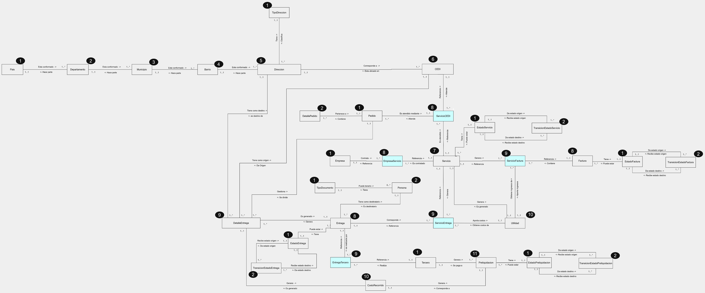

# Modelo de dominio

[Volver al proyecto](../README.md)

[Abrir diagrama en tamaño completo](imagenes/dominio.png)

## Contenido

| Objeto | Caracterización y responsabilidades | Datos de ejemplo | Políticas | Eventos |
| --- | --- | --- | --- | --- |
| Empresa | [Caracterización y responsabilidades](dominio/empresa.md#dominio-s31) | [Datos de ejemplo](dominio/empresa.md#dominio-s32) |  | [Eventos y colaboración](dominio/empresa.md#dominio-s33) |
| EstadoEntrega | [Caracterización y responsabilidades](dominio/estado-entrega.md#dominio-s47) | [Datos de ejemplo](dominio/estado-entrega.md#dominio-s48) | [Políticas](dominio/estado-entrega.md#dominio-s50) | [Eventos y colaboración](dominio/estado-entrega.md#dominio-s49) |
| EstadoFactura | [Caracterización y responsabilidades](dominio/estado-factura.md#dominio-s51) | [Datos de ejemplo](dominio/estado-factura.md#dominio-s52) | [Políticas](dominio/estado-factura.md#dominio-s54) | [Eventos y colaboración](dominio/estado-factura.md#dominio-s53) |
| EstadoPreliquidacion | [Caracterización y responsabilidades](dominio/estado-preliquidacion.md#dominio-s55) | [Datos de ejemplo](dominio/estado-preliquidacion.md#dominio-s56) | [Políticas](dominio/estado-preliquidacion.md#dominio-s58) | [Eventos y colaboración](dominio/estado-preliquidacion.md#dominio-s57) |
| EstadoServicio | [Caracterización y responsabilidades](dominio/estado-servicio.md#dominio-s59) | [Datos de ejemplo](dominio/estado-servicio.md#dominio-s60) | [Políticas](dominio/estado-servicio.md#dominio-s62) | [Eventos y colaboración](dominio/estado-servicio.md#dominio-s61) |
| Pais | [Caracterización y responsabilidades](dominio/pais.md#dominio-s71) | [Datos de ejemplo](dominio/pais.md#dominio-s72) | [Políticas](dominio/pais.md#dominio-s74) | [Eventos y colaboración](dominio/pais.md#dominio-s73) |
| Pedido | [Caracterización y responsabilidades](dominio/pedido.md#dominio-s75) | [Datos de ejemplo](dominio/pedido.md#dominio-s76) | [Políticas](dominio/pedido.md#dominio-s78) | [Eventos y colaboración](dominio/pedido.md#dominio-s77) |
| Tercero | [Caracterización y responsabilidades](dominio/tercero.md#dominio-s103) | [Datos de ejemplo](dominio/tercero.md#dominio-s104) | [Políticas](dominio/tercero.md#dominio-s106) | [Eventos y colaboración](dominio/tercero.md#dominio-s105) |
| TipoDireccion | [Caracterización y responsabilidades](dominio/tipo-direccion.md#dominio-s111) | [Datos de ejemplo](dominio/tipo-direccion.md#dominio-s108) | [Políticas](dominio/tipo-direccion.md#dominio-s110) | [Eventos y colaboración](dominio/tipo-direccion.md#dominio-s109) |
| TipoDocumento | [Caracterización y responsabilidades](dominio/tipo-documento.md#dominio-s107) | [Datos de ejemplo](dominio/tipo-documento.md#dominio-s112) | [Políticas](dominio/tipo-documento.md#dominio-s114) | [Eventos y colaboración](dominio/tipo-documento.md#dominio-s113) |
| DetallePedido | [Caracterización y responsabilidades](dominio/detalle-pedido.md#dominio-s23) | [Datos de ejemplo](dominio/detalle-pedido.md#dominio-s24) | [Políticas](dominio/detalle-pedido.md#dominio-s26) | [Eventos y colaboración](dominio/detalle-pedido.md#dominio-s25) |
| Departamento | [Caracterización y responsabilidades](dominio/departamento.md#dominio-s15) | [Datos de ejemplo](dominio/departamento.md#dominio-s16) | [Políticas](dominio/departamento.md#dominio-s34) | [Eventos y colaboración](dominio/departamento.md#dominio-s17) |
| TransicionEstadoEntrega | [Caracterización y responsabilidades](dominio/transicion-estado-entrega.md#dominio-s115) | [Datos de ejemplo](dominio/transicion-estado-entrega.md#dominio-s116) | [Políticas](dominio/transicion-estado-entrega.md#dominio-s118) | [Eventos y colaboración](dominio/transicion-estado-entrega.md#dominio-s117) |
| TransicionEstadoFactura | [Caracterización y responsabilidades](dominio/transicion-estado-factura.md#dominio-s119) | [Datos de ejemplo](dominio/transicion-estado-factura.md#dominio-s120) | [Políticas](dominio/transicion-estado-factura.md#dominio-s122) | [Eventos y colaboración](dominio/transicion-estado-factura.md#dominio-s121) |
| TransicionEstadoPreliquidacion | [Caracterización y responsabilidades](dominio/transicion-estado-preliquidacion.md#dominio-s123) | [Datos de ejemplo](dominio/transicion-estado-preliquidacion.md#dominio-s124) | [Políticas](dominio/transicion-estado-preliquidacion.md#dominio-s126) | [Eventos y colaboración](dominio/transicion-estado-preliquidacion.md#dominio-s125) |
| TransicionEstadoServicio | [Caracterización y responsabilidades](dominio/transicion-estado-servicio.md#dominio-s127) | [Datos de ejemplo](dominio/transicion-estado-servicio.md#dominio-s128) | [Políticas](dominio/transicion-estado-servicio.md#dominio-s130) | [Eventos y colaboración](dominio/transicion-estado-servicio.md#dominio-s129) |
| Persona | [Caracterización y responsabilidades](dominio/persona.md#dominio-s79) | [Datos de ejemplo](dominio/persona.md#dominio-s80) | [Políticas](dominio/persona.md#dominio-s82) | [Eventos y colaboración](dominio/persona.md#dominio-s81) |
| Municipio | [Caracterización y responsabilidades](dominio/municipio.md#dominio-s67) | [Datos de ejemplo](dominio/municipio.md#dominio-s68) | [Políticas](dominio/municipio.md#dominio-s70) | [Eventos y colaboración](dominio/municipio.md#dominio-s69) |
| Barrio | [Caracterización y responsabilidades](dominio/barrio.md#dominio-s3) | [Datos de ejemplo](dominio/barrio.md#dominio-s4) | [Políticas](dominio/barrio.md#dominio-s5) | [Eventos y colaboración](dominio/barrio.md#dominio-s6) |
| Direccion | [Caracterización y responsabilidades](dominio/direccion.md#dominio-s27) | [Datos de ejemplo](dominio/direccion.md#dominio-s28) | [Políticas](dominio/direccion.md#dominio-s30) | [Eventos y colaboración](dominio/direccion.md#dominio-s29) |
| CEDI | [Caracterización y responsabilidades](dominio/cedi.md#dominio-s7) | [Datos de ejemplo](dominio/cedi.md#dominio-s8) | [Políticas](dominio/cedi.md#dominio-s10) | [Eventos y colaboración](dominio/cedi.md#dominio-s9) |
| Servicio | [Caracterización y responsabilidades](dominio/servicio.md#dominio-s87) | [Datos de ejemplo](dominio/servicio.md#dominio-s88) | [Políticas](dominio/servicio.md#dominio-s90) | [Eventos y colaboración](dominio/servicio.md#dominio-s89) |
| Entrega | [Caracterización y responsabilidades](dominio/entrega.md#dominio-s39) | [Datos de ejemplo](dominio/entrega.md#dominio-s40) | [Políticas](dominio/entrega.md#dominio-s42) | [Eventos y colaboración](dominio/entrega.md#dominio-s41) |
| EmpresaServicio | [Caracterización y responsabilidades](dominio/empresa-servicio.md#dominio-s35) | [Datos de ejemplo](dominio/empresa-servicio.md#dominio-s36) | [Políticas](dominio/empresa-servicio.md#dominio-s38) | [Eventos y colaboración](dominio/empresa-servicio.md#dominio-s37) |
| Factura | [Caracterización y responsabilidades](dominio/factura.md#dominio-s63) | [Datos de ejemplo](dominio/factura.md#dominio-s64) | [Políticas](dominio/factura.md#dominio-s66) | [Eventos y colaboración](dominio/factura.md#dominio-s65) |
| ServicioCEDI | [Caracterización y responsabilidades](dominio/servicio-cedi.md#dominio-s91) | [Datos de ejemplo](dominio/servicio-cedi.md#dominio-s92) | [Políticas](dominio/servicio-cedi.md#dominio-s94) | [Eventos y colaboración](dominio/servicio-cedi.md#dominio-s93) |
| DetalleEntrega | [Caracterización y responsabilidades](dominio/detalle-entrega.md#dominio-s19) | [Datos de ejemplo](dominio/detalle-entrega.md#dominio-s20) | [Políticas](dominio/detalle-entrega.md#dominio-s22) | [Eventos y colaboración](dominio/detalle-entrega.md#dominio-s21) |
| EntregaTercero | [Caracterización y responsabilidades](dominio/entrega-tercero.md#dominio-s43) | [Datos de ejemplo](dominio/entrega-tercero.md#dominio-s44) | [Políticas](dominio/entrega-tercero.md#dominio-s46) | [Eventos y colaboración](dominio/entrega-tercero.md#dominio-s45) |
| ServicioEntrega | [Caracterización y responsabilidades](dominio/servicio-entrega.md#dominio-s95) | [Datos de ejemplo](dominio/servicio-entrega.md#dominio-s96) | [Políticas](dominio/servicio-entrega.md#dominio-s98) | [Eventos y colaboración](dominio/servicio-entrega.md#dominio-s97) |
| ServicioFactura | [Caracterización y responsabilidades](dominio/servicio-factura.md#dominio-s99) | [Datos de ejemplo](dominio/servicio-factura.md#dominio-s100) | [Políticas](dominio/servicio-factura.md#dominio-s102) | [Eventos y colaboración](dominio/servicio-factura.md#dominio-s101) |
| CostoRecorrido | [Caracterización y responsabilidades](dominio/costo-recorrido.md#dominio-s11) | [Datos de ejemplo](dominio/costo-recorrido.md#dominio-s12) | [Políticas](dominio/costo-recorrido.md#dominio-s14) | [Eventos y colaboración](dominio/costo-recorrido.md#dominio-s13) |
| Utilidad | [Caracterización y responsabilidades](dominio/utilidad.md#dominio-s131) | [Datos de ejemplo](dominio/utilidad.md#dominio-s132) | [Políticas](dominio/utilidad.md#dominio-s134) | [Eventos y colaboración](dominio/utilidad.md#dominio-s133) |
| Preliquidación | [Caracterización y responsabilidades](dominio/preliquidacion.md#dominio-s83) | [Datos de ejemplo](dominio/preliquidacion.md#dominio-s84) | [Políticas](dominio/preliquidacion.md#dominio-s86) | [Eventos y colaboración](dominio/preliquidacion.md#dominio-s85) |

## Índice del modelo original

## modelo de dominio

<table>
<tr>
<td><a href="modelo-dominio.md#dominio-s2-a1">Ir a Objetos de dominio&gt;&gt;&gt;</a></td>
</tr>
</table>

## objetos de dominio

<table>
<tr>
<td><a href="modelo-dominio.md#dominio-s1-a1">&lt;&lt;&lt;Ir a modelo de dominio</a></td>
<td></td>
<td></td>
<td></td>
<td></td>
<td></td>
<td></td>
</tr>
<tr>
<td>Nombre</td>
<td>Descripcion</td>
<td>Linea de vida </td>
<td>Datos</td>
<td>Caracterizacion</td>
<td>Eventos</td>
<td>Politicas</td>
</tr>
<tr>
<td>Empresa</td>
<td>Representa la empresa de venta por catalogo que contrata los servicios de la empresa logística para gestionar el traslado y entrega de su mercancía a los destinatarios finales</td>
<td>1</td>
<td><a href="dominio/empresa.md#dominio-s32-a1">Ver</a></td>
<td><a href="dominio/empresa.md#dominio-s31-a1">Ver</a></td>
<td><a href="dominio/empresa.md#dominio-s33-a1">Ver</a></td>
<td><a href="dominio/departamento.md#dominio-s34-a1">Ver</a></td>
</tr>
<tr>
<td>EstadoEntrega</td>
<td>Representa cada uno de los estados disponibles para una entrega</td>
<td>1</td>
<td><a href="dominio/estado-entrega.md#dominio-s48-a1">Ver</a></td>
<td><a href="dominio/estado-entrega.md#dominio-s47-a1">Ver</a></td>
<td><a href="dominio/estado-entrega.md#dominio-s49-a1">Ver</a></td>
<td><a href="dominio/estado-entrega.md#dominio-s50-a1">Ver</a></td>
</tr>
<tr>
<td>EstadoFactura</td>
<td>Representa cada uno de los estados disponibles para una factura</td>
<td>1</td>
<td><a href="dominio/estado-factura.md#dominio-s52-a1">Ver</a></td>
<td><a href="dominio/estado-factura.md#dominio-s51-a1">Ver</a></td>
<td><a href="dominio/estado-factura.md#dominio-s53-a1">Ver</a></td>
<td><a href="dominio/estado-factura.md#dominio-s54-a1">Ver</a></td>
</tr>
<tr>
<td>EstadoPreliquidacion</td>
<td>Representa cada uno de los estados disponibles para una preliquidación</td>
<td>1</td>
<td><a href="dominio/estado-preliquidacion.md#dominio-s56-a1">Ver</a></td>
<td><a href="dominio/estado-preliquidacion.md#dominio-s55-a1">Ver</a></td>
<td><a href="dominio/estado-preliquidacion.md#dominio-s57-a1">Ver</a></td>
<td><a href="dominio/estado-preliquidacion.md#dominio-s58-a1">Ver</a></td>
</tr>
<tr>
<td>EstadoServicio</td>
<td>Representa cada uno de los estados disponibles para un servicio</td>
<td>1</td>
<td><a href="dominio/estado-servicio.md#dominio-s60-a1">Ver</a></td>
<td><a href="dominio/estado-servicio.md#dominio-s59-a1">Ver</a></td>
<td><a href="dominio/estado-servicio.md#dominio-s61-a1">Ver</a></td>
<td><a href="dominio/estado-servicio.md#dominio-s62-a1">Ver</a></td>
</tr>
<tr>
<td>Pais</td>
<td>Representa a cada uno de los países a los que pertenecen los departamentos , municipios y direcciones</td>
<td>1</td>
<td><a href="dominio/pais.md#dominio-s72-a1">Ver</a></td>
<td><a href="dominio/pais.md#dominio-s71-a1">Ver</a></td>
<td><a href="dominio/pais.md#dominio-s73-a1">Ver</a></td>
<td><a href="dominio/pais.md#dominio-s74-a1">Ver</a></td>
</tr>
<tr>
<td>Pedido</td>
<td>Representa aquello que la empresa de venta por catalogo solicita transportar y entregar mediante el servicio logístico contratado</td>
<td>1</td>
<td><a href="dominio/pedido.md#dominio-s76-a1">Ver</a></td>
<td><a href="dominio/pedido.md#dominio-s75-a1">Ver</a></td>
<td><a href="dominio/pedido.md#dominio-s77-a1">Ver</a></td>
<td><a href="dominio/pedido.md#dominio-s78-a1">Ver</a></td>
</tr>
<tr>
<td>Tercero</td>
<td>Empresa externa que realiza las entregas y genera costos</td>
<td>1</td>
<td><a href="dominio/tercero.md#dominio-s104-a1">Ver</a></td>
<td><a href="dominio/tercero.md#dominio-s103-a1">Ver</a></td>
<td><a href="dominio/tercero.md#dominio-s105-a1">Ver</a></td>
<td><a href="dominio/tercero.md#dominio-s106-a1">Ver</a></td>
</tr>
<tr>
<td>TipoDireccion</td>
<td>Representa el tipo de ubicación al que corresponde una dirección dentro del sistema</td>
<td>1</td>
<td><a href="dominio/tipo-direccion.md#dominio-s108-a1">Ver</a></td>
<td><a href="dominio/tipo-documento.md#dominio-s107-a1">Ver</a></td>
<td><a href="dominio/tipo-direccion.md#dominio-s109-a1">Ver</a></td>
<td><a href="dominio/tipo-direccion.md#dominio-s110-a1">Ver</a></td>
</tr>
<tr>
<td>TipoDocumento</td>
<td>Representa el tipo de documento utilizado para identificar a una persona.</td>
<td>1</td>
<td><a href="dominio/tipo-documento.md#dominio-s112-a1">Ver</a></td>
<td><a href="dominio/tipo-direccion.md#dominio-s111-a1">Ver</a></td>
<td><a href="dominio/tipo-documento.md#dominio-s113-a1">Ver</a></td>
<td><a href="dominio/tipo-documento.md#dominio-s114-a1">Ver</a></td>
</tr>
<tr>
<td>DetallePedido</td>
<td>Representa la información específica que permite conocer qué contiene un pedido que debe ser trasladado.</td>
<td>2</td>
<td><a href="dominio/detalle-pedido.md#dominio-s24-a1">Ver</a></td>
<td><a href="dominio/detalle-pedido.md#dominio-s23-a1">Ver</a></td>
<td><a href="dominio/detalle-pedido.md#dominio-s25-a1">Ver</a></td>
<td><a href="dominio/detalle-pedido.md#dominio-s26-a1">Ver</a></td>
</tr>
<tr>
<td>Departamento</td>
<td>Representa a cada uno de los departamentos de un país, donde se encuentran los municipios y direcciones</td>
<td>2</td>
<td><a href="dominio/departamento.md#dominio-s16-a1">Ver</a></td>
<td><a href="dominio/departamento.md#dominio-s15-a1">Ver</a></td>
<td><a href="dominio/departamento.md#dominio-s17-a1">Ver</a></td>
<td><a href="dominio/departamento.md#dominio-s18-a1">Ver</a></td>
</tr>
<tr>
<td>TransicionEstadoEntrega</td>
<td>Representa un cambio permitido desde un estado de entrega hacia otro estado del mismo objeto.</td>
<td>2</td>
<td><a href="dominio/transicion-estado-entrega.md#dominio-s116-a1">Ver</a></td>
<td><a href="dominio/transicion-estado-entrega.md#dominio-s115-a1">Ver</a></td>
<td><a href="dominio/transicion-estado-entrega.md#dominio-s117-a1">Ver</a></td>
<td><a href="dominio/transicion-estado-entrega.md#dominio-s118-a1">Ver</a></td>
</tr>
<tr>
<td>TransicionEstadoFactura</td>
<td>Representa un cambio permitido desde un estado de factura hacia otro estado del mismo objeto.</td>
<td>2</td>
<td><a href="dominio/transicion-estado-factura.md#dominio-s120-a1">Ver</a></td>
<td><a href="dominio/transicion-estado-factura.md#dominio-s119-a1">Ver</a></td>
<td><a href="dominio/transicion-estado-factura.md#dominio-s121-a1">Ver</a></td>
<td><a href="dominio/transicion-estado-factura.md#dominio-s122-a1">Ver</a></td>
</tr>
<tr>
<td>TransicionEstadoPreliquidacion</td>
<td>Representa un cambio permitido desde un estado de preliquidacion hacia otro estado del mismo objeto.</td>
<td>2</td>
<td><a href="dominio/transicion-estado-preliquidacion.md#dominio-s124-a1">Ver</a></td>
<td><a href="dominio/transicion-estado-preliquidacion.md#dominio-s123-a1">Ver</a></td>
<td><a href="dominio/transicion-estado-preliquidacion.md#dominio-s125-a1">Ver</a></td>
<td><a href="dominio/transicion-estado-preliquidacion.md#dominio-s126-a1">Ver</a></td>
</tr>
<tr>
<td>TransicionEstadoServicio</td>
<td>Representa un cambio permitido desde un estado de servicio hacia otro estado del mismo objeto.</td>
<td>2</td>
<td><a href="dominio/transicion-estado-servicio.md#dominio-s128-a1">Ver</a></td>
<td><a href="dominio/transicion-estado-servicio.md#dominio-s127-a1">Ver</a></td>
<td><a href="dominio/transicion-estado-servicio.md#dominio-s129-a1">Ver</a></td>
<td><a href="dominio/transicion-estado-servicio.md#dominio-s130-a1">Ver</a></td>
</tr>
<tr>
<td>Persona</td>
<td>Representa a la persona relacionada con una operación logística, principalmente como destinatario de una entrega, almacenando sus datos de identificación y contacto.</td>
<td>2</td>
<td><a href="dominio/persona.md#dominio-s80-a1">Ver</a></td>
<td><a href="dominio/persona.md#dominio-s79-a1">Ver</a></td>
<td><a href="dominio/persona.md#dominio-s81-a1">Ver</a></td>
<td><a href="dominio/persona.md#dominio-s82-a1">Ver</a></td>
</tr>
<tr>
<td>Municipio</td>
<td>Representa a cada uno de los municipios de los departamentos de un país</td>
<td>3</td>
<td><a href="dominio/municipio.md#dominio-s68-a1">Ver</a></td>
<td><a href="dominio/municipio.md#dominio-s67-a1">Ver</a></td>
<td><a href="dominio/municipio.md#dominio-s69-a1">Ver</a></td>
<td><a href="dominio/municipio.md#dominio-s70-a1">Ver</a></td>
</tr>
<tr>
<td>Barrio</td>
<td>Representa a cada uno de los barrios o veredas de los municipios de los departamentos de un pais</td>
<td>4</td>
<td><a href="dominio/barrio.md#dominio-s4-a1">Ver</a></td>
<td><a href="dominio/barrio.md#dominio-s3-a1">Ver</a></td>
<td><a href="dominio/barrio.md#dominio-s6-a1">Ver</a></td>
<td><a href="dominio/barrio.md#dominio-s5-a1">Ver</a></td>
</tr>
<tr>
<td>Direccion</td>
<td>Representa cada una de las ubicaciones específicas de los barrios o veredas donde se realizan las recogidas, entregas o se encuentran los CEDI</td>
<td>5</td>
<td><a href="dominio/direccion.md#dominio-s28-a1">Ver</a></td>
<td><a href="dominio/direccion.md#dominio-s27-a1">Ver</a></td>
<td><a href="dominio/direccion.md#dominio-s29-a1">Ver</a></td>
<td><a href="dominio/direccion.md#dominio-s30-a1">Ver</a></td>
</tr>
<tr>
<td>CEDI</td>
<td>Representa el centro de distribución desde el cual la empresa logística recibe o despacha la mercancía para ejecutar los servicios contratados</td>
<td>6</td>
<td><a href="dominio/cedi.md#dominio-s8-a1">Ver</a></td>
<td><a href="dominio/cedi.md#dominio-s7-a1">Ver</a></td>
<td><a href="dominio/cedi.md#dominio-s9-a1">Ver</a></td>
<td><a href="dominio/cedi.md#dominio-s10-a1">Ver</a></td>
</tr>
<tr>
<td>Servicio</td>
<td>Representa el servicio logístico contratado por una empresa para gestionar el transporte y entrega de sus pedidos</td>
<td>7</td>
<td><a href="dominio/servicio.md#dominio-s88-a1">Ver</a></td>
<td><a href="dominio/servicio.md#dominio-s87-a1">Ver</a></td>
<td><a href="dominio/servicio.md#dominio-s89-a1">Ver</a></td>
<td><a href="dominio/servicio.md#dominio-s90-a1">Ver</a></td>
</tr>
<tr>
<td>Entrega</td>
<td>Proceso mediante el cual el pedido es transportado y entregado al cliente</td>
<td>8</td>
<td><a href="dominio/entrega.md#dominio-s40-a1">Ver</a></td>
<td><a href="dominio/entrega.md#dominio-s39-a1">Ver</a></td>
<td><a href="dominio/entrega.md#dominio-s41-a1">Ver</a></td>
<td><a href="dominio/entrega.md#dominio-s42-a1">Ver</a></td>
</tr>
<tr>
<td>EmpresaServicio</td>
<td>Representa la relación entre una empresa y un servicio</td>
<td>8</td>
<td><a href="dominio/empresa-servicio.md#dominio-s36-a1">Ver</a></td>
<td><a href="dominio/empresa-servicio.md#dominio-s35-a1">Ver</a></td>
<td><a href="dominio/empresa-servicio.md#dominio-s37-a1">Ver</a></td>
<td><a href="dominio/empresa-servicio.md#dominio-s38-a1">Ver</a></td>
</tr>
<tr>
<td>Factura</td>
<td>Documento comercial que consolida uno o más pedidos</td>
<td>8</td>
<td><a href="dominio/factura.md#dominio-s64-a1">Ver</a></td>
<td><a href="dominio/factura.md#dominio-s63-a1">Ver</a></td>
<td><a href="dominio/factura.md#dominio-s65-a1">Ver</a></td>
<td><a href="dominio/factura.md#dominio-s66-a1">Ver</a></td>
</tr>
<tr>
<td>ServicioCEDI</td>
<td>Representa la relación entre un servicio, un CEDI y los pedidos que deben ser gestionados desde dicho CEDI para la ejecución del servicio</td>
<td>8</td>
<td><a href="dominio/servicio-cedi.md#dominio-s92-a1">Ver</a></td>
<td><a href="dominio/servicio-cedi.md#dominio-s91-a1">Ver</a></td>
<td><a href="dominio/servicio-cedi.md#dominio-s93-a1">Ver</a></td>
<td><a href="dominio/servicio-cedi.md#dominio-s94-a1">Ver</a></td>
</tr>
<tr>
<td>DetalleEntrega</td>
<td>Representa la información de un trayecto específico realizado para ejecutar una entrega dentro de un servicio logístico</td>
<td>9</td>
<td><a href="dominio/detalle-entrega.md#dominio-s20-a1">Ver</a></td>
<td><a href="dominio/detalle-entrega.md#dominio-s19-a1">Ver</a></td>
<td><a href="dominio/detalle-entrega.md#dominio-s21-a1">Ver</a></td>
<td><a href="dominio/detalle-entrega.md#dominio-s22-a1">Ver</a></td>
</tr>
<tr>
<td>EntregaTercero</td>
<td>Representa la relación entre una entrega y un tercero</td>
<td>9</td>
<td><a href="dominio/entrega-tercero.md#dominio-s44-a1">Ver</a></td>
<td><a href="dominio/entrega-tercero.md#dominio-s43-a1">Ver</a></td>
<td><a href="dominio/entrega-tercero.md#dominio-s45-a1">Ver</a></td>
<td><a href="dominio/entrega-tercero.md#dominio-s46-a1">Ver</a></td>
</tr>
<tr>
<td>ServicioEntrega</td>
<td>Representa la relación entre un servicio y una entrega</td>
<td>9</td>
<td><a href="dominio/servicio-entrega.md#dominio-s96-a1">Ver</a></td>
<td><a href="dominio/servicio-entrega.md#dominio-s95-a1">Ver</a></td>
<td><a href="dominio/servicio-entrega.md#dominio-s97-a1">Ver</a></td>
<td><a href="dominio/servicio-entrega.md#dominio-s98-a1">Ver</a></td>
</tr>
<tr>
<td>ServicioFactura</td>
<td>Representa la relación entre un servicio y una factura</td>
<td>9</td>
<td><a href="dominio/servicio-factura.md#dominio-s100-a1">Ver</a></td>
<td><a href="dominio/servicio-factura.md#dominio-s99-a1">Ver</a></td>
<td><a href="dominio/servicio-factura.md#dominio-s101-a1">Ver</a></td>
<td><a href="dominio/servicio-factura.md#dominio-s102-a1">Ver</a></td>
</tr>
<tr>
<td>CostoRecorrido</td>
<td>Representa el costo generado por un recorrido, calculado de acuerdo con la distancia recorrida y el valor establecido por kilómetro.</td>
<td>10</td>
<td><a href="dominio/costo-recorrido.md#dominio-s12-a1">Ver</a></td>
<td><a href="dominio/costo-recorrido.md#dominio-s11-a1">Ver</a></td>
<td><a href="dominio/costo-recorrido.md#dominio-s13-a1">Ver</a></td>
<td><a href="dominio/costo-recorrido.md#dominio-s14-a1">Ver</a></td>
</tr>
<tr>
<td>Utilidad</td>
<td>Representa el resultado obtenido al comparar los ingresos generados por la facturación con los costos asociados a la ejecución de los servicios logísticos.</td>
<td>10</td>
<td><a href="dominio/utilidad.md#dominio-s132-a1">Ver</a></td>
<td><a href="dominio/utilidad.md#dominio-s131-a1">Ver</a></td>
<td><a href="dominio/utilidad.md#dominio-s133-a1">Ver</a></td>
<td><a href="dominio/utilidad.md#dominio-s134-a1">Ver</a></td>
</tr>
<tr>
<td>Preliquidación</td>
<td>Representa el cálculo de los costos que se deben reconocer a un tercero por las entregas realizadas.</td>
<td>11</td>
<td><a href="dominio/preliquidacion.md#dominio-s84-a1">Ver</a></td>
<td><a href="dominio/preliquidacion.md#dominio-s83-a1">Ver</a></td>
<td><a href="dominio/preliquidacion.md#dominio-s85-a1">Ver</a></td>
<td><a href="dominio/preliquidacion.md#dominio-s86-a1">Ver</a></td>
</tr>
</table>

## Referencias pendientes en el Excel de origen

Las siguientes celdas ya contienen referencias rotas o destinos no disponibles en el Excel. Se conserva el contenido disponible sin inventar el dato que falta.

| Hoja | Celda | Situación | Referencia de origen |
| --- | --- | --- | --- |
| Entrega_C | A8 | Referencia rota en el Excel | Entrega_D!#REF! |
| TransicionEstadoEntrega_C | O21 | Referencia rota en el Excel | TransicionEstadoEntrega_P!#REF! |
| TransicionEstadoEntrega_C | O22 | Referencia rota en el Excel | TransicionEstadoEntrega_P!#REF! |
| TransicionEstadoEntrega_C | O23 | Referencia rota en el Excel | TransicionEstadoEntrega_P!#REF! |
| TransicionEstadoEntrega_C | P21 | Referencia rota en el Excel | TransicionEstadoEntrega_P!#REF! |
| TransicionEstadoEntrega_C | P22 | Referencia rota en el Excel | TransicionEstadoEntrega_P!#REF! |
| TransicionEstadoEntrega_C | P23 | Referencia rota en el Excel | TransicionEstadoEntrega_P!#REF! |
| TransicionEstadoFactura_C | O21 | Referencia rota en el Excel | TransicionEstadoFactura_P!#REF! |
| TransicionEstadoFactura_C | O22 | Referencia rota en el Excel | TransicionEstadoFactura_P!#REF! |
| TransicionEstadoFactura_C | O23 | Referencia rota en el Excel | TransicionEstadoFactura_P!#REF! |
| TransicionEstadoFactura_C | P21 | Referencia rota en el Excel | TransicionEstadoFactura_P!#REF! |
| TransicionEstadoFactura_C | P22 | Referencia rota en el Excel | TransicionEstadoFactura_P!#REF! |
| TransicionEstadoFactura_C | P23 | Referencia rota en el Excel | TransicionEstadoFactura_P!#REF! |
| TransicionEstadoPreliq_C | O21 | Referencia rota en el Excel | TransicionEstadoPreliq_P!#REF! |
| TransicionEstadoPreliq_C | O22 | Referencia rota en el Excel | TransicionEstadoPreliq_P!#REF! |
| TransicionEstadoPreliq_C | O23 | Referencia rota en el Excel | TransicionEstadoPreliq_P!#REF! |
| TransicionEstadoPreliq_C | P21 | Referencia rota en el Excel | TransicionEstadoPreliq_P!#REF! |
| TransicionEstadoPreliq_C | P22 | Referencia rota en el Excel | TransicionEstadoPreliq_P!#REF! |
| TransicionEstadoPreliq_C | P23 | Referencia rota en el Excel | TransicionEstadoPreliq_P!#REF! |
| TransicionEstadoServicio_C | O21 | Referencia rota en el Excel | TransicionEstadoServicio_P!#REF! |
| TransicionEstadoServicio_C | O22 | Referencia rota en el Excel | TransicionEstadoServicio_P!#REF! |
| TransicionEstadoServicio_C | O23 | Referencia rota en el Excel | TransicionEstadoServicio_P!#REF! |
| TransicionEstadoServicio_C | P21 | Referencia rota en el Excel | TransicionEstadoServicio_P!#REF! |
| TransicionEstadoServicio_C | P22 | Referencia rota en el Excel | TransicionEstadoServicio_P!#REF! |
| TransicionEstadoServicio_C | P23 | Referencia rota en el Excel | TransicionEstadoServicio_P!#REF! |
