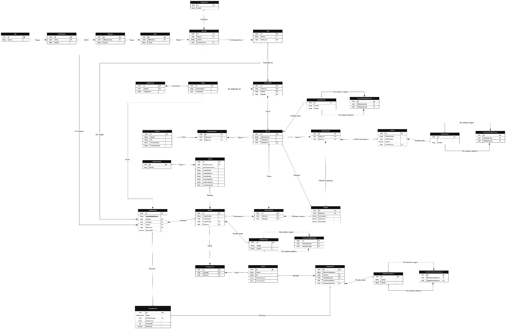

# Modelo entidad-relación

[Volver al proyecto](../README.md)

[Abrir diagrama en tamaño completo](imagenes/mer.png)

## Contenido

| Entidad | Detalle |
| --- | --- |
| Empresa | [Consultar](mer/empresa.md) |
| EstadoEntrega | [Consultar](mer/estado-entrega.md) |
| EstadoFactura | [Consultar](mer/estado-factura.md) |
| EstadoPreliquidacion | [Consultar](mer/estado-preliquidacion.md) |
| EstadoServicio | [Consultar](mer/estado-servicio.md) |
| Pais | [Consultar](mer/pais.md) |
| Pedido | [Consultar](mer/pedido.md) |
| Tercero | [Consultar](mer/tercero.md) |
| TipoDireccion | [Consultar](mer/tipo-direccion.md) |
| TipoDocumento | [Consultar](mer/tipo-documento.md) |
| DetallePedido | [Consultar](mer/detalle-pedido.md) |
| Departamento | [Consultar](mer/departamento.md) |
| TransicionEstadoEntrega | [Consultar](mer/transicion-estado-entrega.md) |
| TransicionEstadoFactura | [Consultar](mer/transicion-estado-factura.md) |
| TransicionEstadoPreliquidacion | [Consultar](mer/transicion-estado-preliquidacion.md) |
| TransicionEstadoServicio | [Consultar](mer/transicion-estado-servicio.md) |
| Persona | [Consultar](mer/persona.md) |
| Municipio | [Consultar](mer/municipio.md) |
| Barrio | [Consultar](mer/barrio.md) |
| Direccion | [Consultar](mer/direccion.md) |
| CEDI | [Consultar](mer/cedi.md) |
| Servicio | [Consultar](mer/servicio.md) |
| Entrega | [Consultar](mer/entrega.md) |
| EmpresaServicio | [Consultar](mer/empresa-servicio.md) |
| Factura | [Consultar](mer/factura.md) |
| ServicioCEDI | [Consultar](mer/servicio-cedi.md) |
| DetalleEntrega | [Consultar](mer/detalle-entrega.md) |
| EntregaTercero | [Consultar](mer/entrega-tercero.md) |
| ServicioEntrega | [Consultar](mer/servicio-entrega.md) |
| ServicioFactura | [Consultar](mer/servicio-factura.md) |
| CostoRecorrido | [Consultar](mer/costo-recorrido.md) |
| Utilidad | [Consultar](mer/utilidad.md) |
| Preliquidacion | [Consultar](mer/preliquidacion.md) |

## Índice del modelo original

## MER

## Entidades

<table>
<tr>
<td>Entidad</td>
<td>Descripción</td>
</tr>
<tr>
<td><a href="mer/empresa.md#mer-s3-a1">Empresa</a></td>
<td>Representa la empresa de venta por catalogo que contrata los servicios de la empresa logística para gestionar el traslado y entrega de su mercancía a los destinatarios finales</td>
</tr>
<tr>
<td><a href="mer/estado-entrega.md#mer-s4-a1">EstadoEntrega</a></td>
<td>Representa cada uno de los estados definidos para una entrega.</td>
</tr>
<tr>
<td><a href="mer/estado-factura.md#mer-s5-a1">EstadoFactura</a></td>
<td>Representa cada uno de los estados definidos para una factura.</td>
</tr>
<tr>
<td><a href="mer/estado-preliquidacion.md#mer-s6-a1">EstadoPreliquidacion</a></td>
<td>Representa cada uno de los estados definidos para una preliquidación.</td>
</tr>
<tr>
<td><a href="mer/estado-servicio.md#mer-s7-a1">EstadoServicio</a></td>
<td>Representa cada uno de los estados definidos para un servicio.</td>
</tr>
<tr>
<td><a href="mer/pais.md#mer-s8-a1">Pais</a></td>
<td>Representa a cada uno de los países a los que pertenecen los departamentos , municipios y direcciones</td>
</tr>
<tr>
<td><a href="mer/pedido.md#mer-s9-a1">Pedido</a></td>
<td>Representa aquello que la empresa de venta por catalogo solicita transportar y entregar mediante el servicio logístico contratado</td>
</tr>
<tr>
<td><a href="mer/tercero.md#mer-s10-a1">Tercero</a></td>
<td>Empresa externa que realiza las entregas y genera costos</td>
</tr>
<tr>
<td><a href="mer/tipo-direccion.md#mer-s11-a1">TipoDireccion</a></td>
<td>Representa el tipo de ubicación al que corresponde una dirección dentro del sistema</td>
</tr>
<tr>
<td><a href="mer/tipo-documento.md#mer-s12-a1">TipoDocumento</a></td>
<td>Representa el tipo de documento utilizado para identificar a una persona.</td>
</tr>
<tr>
<td><a href="mer/detalle-pedido.md#mer-s13-a1">DetallePedido</a></td>
<td>Representa la información específica que permite conocer qué contiene un pedido que debe ser trasladado.</td>
</tr>
<tr>
<td><a href="mer/departamento.md#mer-s14-a1">Departamento</a></td>
<td>Representa a cada uno de los departamentos de un país, donde se encuentran los municipios y direcciones</td>
</tr>
<tr>
<td><a href="mer/transicion-estado-entrega.md#mer-s15-a1">TransicionEstadoEntrega</a></td>
<td>Representa una transición permitida entre un estado de origen y un estado de destino de la entrega.</td>
</tr>
<tr>
<td><a href="mer/transicion-estado-factura.md#mer-s16-a1">TransicionEstadoFactura</a></td>
<td>Representa una transición permitida entre un estado de origen y un estado de destino de la factura.</td>
</tr>
<tr>
<td><a href="mer/transicion-estado-preliquidacion.md#mer-s17-a1">TransicionEstadoPreliquidacion</a></td>
<td>Representa una transición permitida entre un estado de origen y un estado de destino de la preliquidación.</td>
</tr>
<tr>
<td><a href="mer/transicion-estado-servicio.md#mer-s18-a1">TransicionEstadoServicio</a></td>
<td>Representa una transición permitida entre un estado de origen y un estado de destino del servicio.</td>
</tr>
<tr>
<td><a href="mer/persona.md#mer-s19-a1">Persona</a></td>
<td>Representa a la persona relacionada con una operación logística, principalmente como destinatario de una entrega, almacenando sus datos de identificación y contacto.</td>
</tr>
<tr>
<td><a href="mer/municipio.md#mer-s20-a1">Municipio</a></td>
<td>Representa a cada uno de los municipios de los departamentos de un país</td>
</tr>
<tr>
<td><a href="mer/barrio.md#mer-s21-a1">Barrio</a></td>
<td>Representa a cada uno de los barrios o veredas de los municipios de los departamentos de un pais</td>
</tr>
<tr>
<td><a href="mer/direccion.md#mer-s22-a1">Direccion</a></td>
<td>Representa cada una de las ubicaciones específicas de los barrios o veredas donde se realizan las recogidas, entregas o se encuentran los CEDI</td>
</tr>
<tr>
<td><a href="mer/cedi.md#mer-s23-a1">CEDI</a></td>
<td>Representa el centro de distribución desde el cual la empresa logística recibe o despacha la mercancía para ejecutar los servicios contratados</td>
</tr>
<tr>
<td><a href="mer/servicio.md#mer-s24-a1">Servicio</a></td>
<td>Representa el servicio logístico contratado por una empresa para gestionar el transporte y entrega de sus pedidos</td>
</tr>
<tr>
<td><a href="mer/entrega.md#mer-s25-a1">Entrega</a></td>
<td>Proceso mediante el cual el pedido es transportado y entregado al cliente</td>
</tr>
<tr>
<td><a href="mer/empresa-servicio.md#mer-s26-a1">EmpresaServicio</a></td>
<td>Representa la relación entre una empresa y un servicio</td>
</tr>
<tr>
<td><a href="mer/factura.md#mer-s27-a1">Factura</a></td>
<td>Documento comercial que consolida uno o más pedidos</td>
</tr>
<tr>
<td><a href="mer/servicio-cedi.md#mer-s28-a1">ServicioCEDI</a></td>
<td>Representa la relación entre un servicio, un CEDI y los pedidos que deben ser gestionados desde dicho CEDI para la ejecución del servicio</td>
</tr>
<tr>
<td><a href="mer/detalle-entrega.md#mer-s29-a1">DetalleEntrega</a></td>
<td>Representa la información de un trayecto específico realizado para ejecutar una entrega dentro de un servicio logístico</td>
</tr>
<tr>
<td><a href="mer/entrega-tercero.md#mer-s30-a1">EntregaTercero</a></td>
<td>Representa la relación entre una entrega y un tercero</td>
</tr>
<tr>
<td><a href="mer/servicio-entrega.md#mer-s31-a1">ServicioEntrega</a></td>
<td>Representa la relación entre un servicio y una entrega</td>
</tr>
<tr>
<td><a href="mer/servicio-factura.md#mer-s32-a1">ServicioFactura</a></td>
<td>Representa la relación entre un servicio y una factura</td>
</tr>
<tr>
<td><a href="mer/costo-recorrido.md#mer-s33-a1">CostoRecorrido</a></td>
<td>Representa el costo generado por un recorrido, calculado de acuerdo con la distancia recorrida y el valor establecido por kilómetro.</td>
</tr>
<tr>
<td><a href="mer/utilidad.md#mer-s34-a1">Utilidad</a></td>
<td>Representa el resultado obtenido al comparar los ingresos generados por la facturación con los costos asociados a la ejecución de los servicios logísticos.</td>
</tr>
<tr>
<td><a href="mer/preliquidacion.md#mer-s35-a1">Preliquidacion</a></td>
<td>Representa el cálculo de los costos que se deben reconocer a un tercero por las entregas realizadas.</td>
</tr>
</table>
